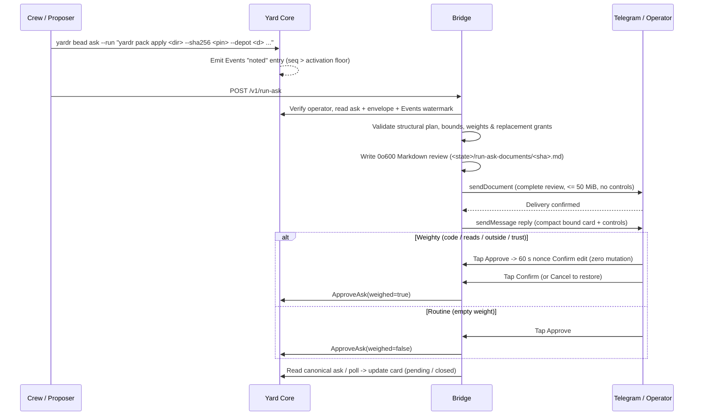

# Depot-pack approvals through Telegram

Design note and activation boundary for importing and approving complete
native `yardr pack apply --depot ...` proposals through Telegram. Extends
the shared native card, bundle and two-tap gate described in
[native source cards](native-source-cards.md) and
[tap confirmation](tap-confirmation.md) without adding new settings keys,
source grants, pack programs or background workers.

## Accepted contract and boundaries

- **Registered directory plans only**: accepts native `git`, `dir` and
  omitted-kind (`None`) pack envelopes targeting an absolute registered
  directory with explicit matching `--sha256`, `--depot` and structured plan
  fields. Reconstructs the argv in core's fixed flag order and requires
  POSIX-parsed `command` words to match `yardr` plus that argv.
- **Refused forms**: embedded, bare, URL, `--summary`, `--yes`, overwrite,
  interactive-input, missing-grant public replacements and out-of-bounds
  proposals refuse whole before sending any message or writing a receipt.
  Through `validate_run_card`, invalid/unsupported depot proposals surface
  `run_ask_invalid_depot_pack_use_terminal; use yardr pack apply <dir> in a terminal; use Footplate or the yard cards`
  and appear as terminal-only (`('terminal-only run', False)`) in `/decide`.
- **No invented manifest**: unlike fork directory source-pack snapshots, the
  bridge invents no setup/manifest snapshot and opens no provenance path on disk;
  whole-pack SHA-256 verification and staleness remain core-owned, while
  carried sources verify standing inventory hashes and complete inverse diffs.
- **Native prose and kept grants**: native `Does` lines are server-owned
  disclosure and remain visible verbatim, bound into the proposal hash.
  Typed `source` actions must reconcile with carried sources, and a replacement
  must explicitly account for standing grants (kept grants also appear on the
  compact reply card summary). Plain public cores that omit replacement grants
  disclosure refuse before send.

## Limits and failure modes

| Surface | Enforced limit | On violation |
| --- | --- | --- |
| Telegram card / Confirm edit | 3500 / 4096 UTF-16 units | Refuses whole; no buttons sent |
| Complete Markdown attachment | 50 MiB (`PACK_DOCUMENT_BYTES`) | Refuses whole before send |
| Native `Does` lines | 1..40 lines | Refuses whole as invalid depot pack |
| `changes` `old` / `new` values | 256 KiB UTF-8 each | Refuses whole |
| Depot `file` `text` / `diff` | 64 KiB each | Refuses whole |
| Carried source declarations | 256 KiB each and 256 KiB aggregate | Refuses whole |
| Carried command file / source total | 64 KiB file; 320 KiB per source | Refuses whole |
| Aggregate depot + carried payload | 64 KiB total (texts, diffs, removals) | Refuses whole |
| Confirm nonce window | 60 seconds (`CONFIRM_SECONDS`) | Consumed on Confirm check; stale or expired does not run |

All byte/line/framing failures and document-delivery ambiguity fail closed:
controls are never attached without confirmed document delivery, Approve on a
weighted card mutates nothing until Confirm, Cancel clears pending state and
restores controls, and stale yard state (`RPCStale`) edits the card to
`Stale depot pack proposal; nothing ran. Decline it in the yard and ask again.`
with controls removed.

## Mechanism: routine vs. weighted and activation watermark

1. **Routine vs. weighted**: `_validate_source_weight` restricts weight tags to
   `{code, reads, outside, trust}`, requiring `code` when carried source files
   differ from standing inventory or `mappings.binds` is non-empty, and `trust`
   when `mappings.members` is non-empty. Genuine non-code, non-trust directory
   updates with empty `weight` (such as metadata/flow/route/group changes without
   carried code or member additions) use one-tap Approve (`weighed=false`),
   while carried code, bindings, membership or other weighted changes enforce the
   60-second Confirm step (`weighed=true`).
2. **Delivery & binding**: the canonical bundle Markdown is saved mode `0o600`
   under `<state_dir>/run-ask-documents/` and delivered first (`sendDocument`). The
   compact card replies to that document message, naming the depot, operation,
   plan counts, kept replacement grants, weight, `Bundle`, `Document`,
   `Pack digest` and undo limits. Row identity binds yard home device/inode,
   settings pairing, conversation, proposal hash, `Bundle` and `Document`.
3. **Global event watermark (`record_depot_cutover`)**: interactive depot
   proposals require a unique `noted` event (`data={'note': ask}`) authored by
   `ask['asker']` strictly after a durable monotone watermark in the
   instance's SQLite `deliveries` table (`runask:depot-cutover:<fingerprint>`
   with `delivered=false`, `failure_kind='permanent'`). The operator records this
   watermark intentionally via `record_depot_cutover()` against `<root>/current`
   while the old bridge process is stopped; ordinary startup, restarts and
   `check-install` never advance it. Earlier asks without a post-cutover event
   remain terminal-only across fresh idempotency keys and `/decide`.

## Independent rollout, retained state and rollback

- **Instance isolation**: follows [independent instances](independent-instances.md).
  `install.sh --settings <file> --root <root>` copies clean committed source
  and `vendor/` into `<root>/releases/<sha>` with `RELEASE` and `SHA256SUMS`;
  the instance service runs only
  `<root>/current/bridge/bridge.py --settings <file> run`. No shared checkout
  import or new `yardr/tgbridge*` source grant is introduced. Because
  `install.sh` defaults `--root` to `~/.local/share/yardr-telegram/<unit stem>`
  when omitted, pass the observed `--root <root>` on dry-run, install and
  rollback (or verify the dry-run's resolved root equals `<root>`) so every step
  targets the same `current`/`previous` tree.
- **Retained ledger & rollback safety**: `<state_dir>/telegram-bridge.sqlite3`
  (`run_asks`, `deliveries`, `run_ask_updates`) and `<state_dir>/run-ask-documents/` live
  outside `releases/`. Rolling back via
  `<root>/current/install.sh --settings <file> --root <root> --rollback`
  (followed by reloading/restarting the unit) switches `current` back to
  `previous` while keeping the ledger, watermark and review documents intact. Older releases
  that predate depot-pack support ignore the permanent `deliveries` watermark
  row and fail closed (`Proposal changed; use Footplate or the yard cards`) with
  controls stripped if an interactive depot card row is touched.

## Compatibility evidence and checkpoints

Compatibility tables are maintained in
[public readiness](../public-readiness.md#capabilities-and-grants) and
[upstream proposal](upstream-proposal.md#frozen-compatibility-evidence) rather
than duplicated here. In summary:

- **Offline preview & fixtures**: `python3 -B scripts/preview_run_asks.py --depot`
  and the checked-in [depot-pack preview](../images/native-depot-pack.html) render
  genuine synthetic fixtures (`depot_first.json`, `depot_matrix_first.json`,
  `depot_matrix_change.json`, `depot_source_replace.json`, plus `_public_main`
  variants) across routine, weighted Confirm, CRLF/Unicode diffs, pending/settled
  and over-bound refusal states.
- **Isolated native verification**: `bridge/test_run_asks.py` (`NativeTests` and
  `RealNativeTests.test_real_native_depot_pack_apply_once`) drives isolated
  aligned and public-main (`52e22d57`) cores across SQLite crashes, poll ordering,
  cutover gating, stale mutations and replay.
- **Explicit boundary**: source landing and offline/isolated tests remain
  distinct from instance installation, activation watermark capture and live
  operator usability verification; public core compatibility claims continue to
  wait for an independent compatible public release gate.
