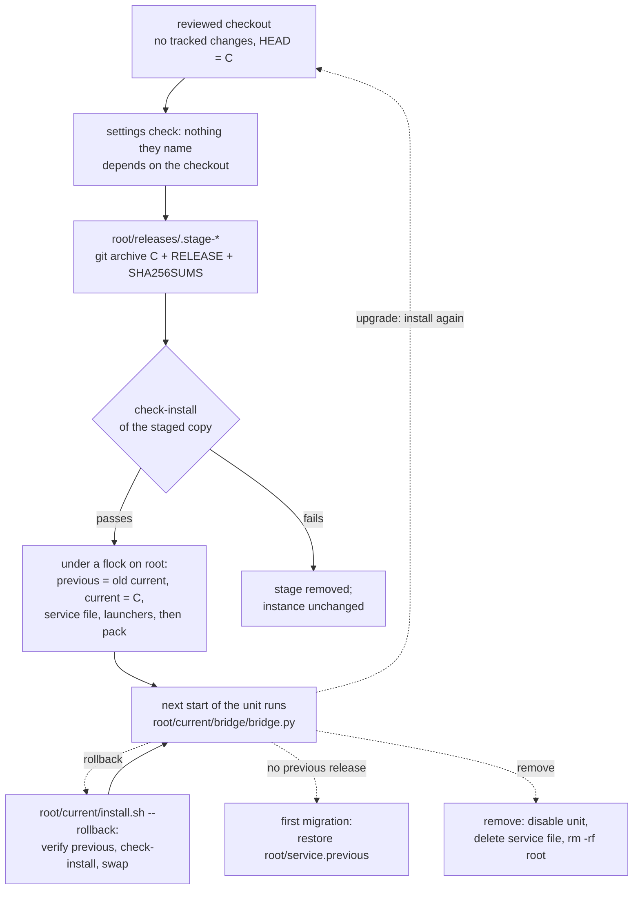

# Independent bridge installations

The decision record for running each yard's bridge as an installation of its
own. The operator's steps are in `yardr/SETUP.md` ("Move an existing bridge to
its own installation"); the install transaction in detail is in
`bridge/OPERATIONS.md` ("Install and launch") and the header of `install.sh`.

## The problem

Every bridge on a host ran `bridge/bridge.py` from one mutable checkout. A
change to the checkout reached every yard at its next start, and moving or
removing the checkout stopped them all. Four more things tied the instances
together:

- `install.sh` rendered each unit's ExecStart from the checkout.
- `install.sh` repointed the host-wide `~/.local/bin/voice-transcribe` at
  whichever checkout ran it last.
- Crew skills were linked from the checkout, and their text named checkout
  paths.
- Each yard's pack import was recorded against the checkout's `yardr/`.

`bridge.py` itself was already self-contained: it finds `run_asks.py`, the
transcriber, `models.sha256` and the unit template beside itself, and imports
the standard library plus its own pinned vendor packages. A copy of the tree
is a complete program. What was missing was a supported copy, a way to activate and roll it back, and the
per-instance pieces around it.

## Decisions

- **2026-11-08, independent instances.** Keep it simple. The same generic product
  runs in every yard, the instances are fully independent, and duplicating
  small code or files is preferred to a shared mutable dependency. Each
  installation is upgraded, rolled back or removed without touching another.
  Existing installations move over through a validated, operator-owned
  hand-off, never through removal followed by manual repair.
- **2026-11-08, remove runtime coupling.** Every instance dependency on
  another instance is removed. Here that is the bridge's runtime, the
  telegram skills' paths and the voice-transcribe link.
- **2026-11-08, explicit Markdown.** Explicit Markdown formatting is
  approved, with a pinned pure-Python parser. Each instance owns its runtime
  copy of it: no shared virtual environment and no install when a message is
  sent. Such dependencies go under the release's `vendor/`.
- The yards differ only in rollout state and enabled ask kinds, not in
  product policy. The named `bases:` of the source declaration (`odyssey`,
  `imd`) are legacy bindings: they stay, and an installation that selects one
  keeps it.

Routine choices made with the design: the layout and default root below,
installing only a committed tree, the link name `current`, committing pinned
packages under `vendor/`, and leaving an existing global
`voice-transcribe` link to the operator.

## Layout

An instance is one settings file. Its name is the unit stem (the settings'
`unit` without `.service`), which is already unique per host. Its root
defaults to `~/.local/share/yardr-telegram/<unit stem>`; `--root` names
another.

```text
<root>/
  releases/<commit>/     git archive of a clean commit, plus RELEASE and SHA256SUMS
  releases/.stage-*      an install in progress (removed when it fails)
  current -> releases/<commit>
  previous -> releases/<commit>
  bin/telegram-bridge    exec <python> <root>/current/bridge/bridge.py --settings <settings> "$@"
  bin/voice-transcribe   exec <python> -B <root>/current/transcriber/voice_transcribe.py "$@"
  packs/<digest>/        a release's yardr/ with its base line naming the settings' port
  pack -> packs/<digest>
  service.previous       the service file the install last replaced (mode 600)
```

The unit (or launchd plist) runs `<python> <root>/current/bridge/bridge.py
--settings <settings> run`. Its name, template and sandbox lines are what they
were; the settings, secrets, `state_dir` and `lock_dir` stay where the
settings put them, outside the root. A release's own pure-Python dependencies,
when it has any, are committed under `<release>/vendor/`, which `bridge.py`
puts first on `sys.path`.

## Lifecycle



**Install and upgrade.** `install.sh --settings <settings> [--root <root>]`,
run from a checkout:

1. checks the system `python3` and the settings, and refuses any path the
   instance would run, read or write inside the checkout: the root, the
   settings file, `python`, the token, both secrets, `state_dir`, `lock_dir`,
   `health_file`, `yardr.home`, each handler and handler write path, and the
   transcriber's `gpu_check`, `whisper_cli` and `models_dir`. Links are
   followed at every component, and each refusal names its remedy. It then
   requires a git work tree with no tracked changes;
2. stages HEAD under `releases/.stage-*`, or reuses `releases/<commit>` when
   its files match the stage's sums and the settings depend on nothing in
   the source its `RELEASE` records;
3. creates a missing callback or hook secret and, with transcription on, the
   host-wide queue directory, each owner-only. These are the only writes
   outside the root before step 4 and are kept whatever happens next;
4. runs the staged or reused release's `check-install` under the settings'
   `python`. A failure removes the stage and changes nothing else;
5. activates, holding an exclusive `flock` on the root so one activation runs
   at a time, with SIGINT, SIGTERM and SIGHUP held until the renames or their
   undo are done: `previous` becomes the old `current`, `current` the
   release, then the service file (the replaced one kept in
   `service.previous`) and the launchers are written, each only when its
   bytes or mode changed, and `pack` moves last to the release's rendered
   generation. Everything is written beside its place and renamed in; a
   failed rename puts back what was already replaced.

Install never starts, stops or restarts a service and never contacts
Telegram. Where the settings name a `[yardr] home`, `check-install` (in a
dry-run too) asks that yard's socket for the operator, a read, so that yard
must be running; install writes nothing to it. It prints the `next:` line
the operator runs. Because `current` moves at activation, the new release is
what the unit runs at its next start, whoever starts it, including a
`Restart=` after a crash.

**Rollback.** `<root>/current/install.sh --settings <settings> --rollback`
runs from any release and needs no git. It verifies `previous` against its
`SHA256SUMS`, runs its `check-install`, and swaps `current` and `previous`
under the same lock; `pack` returns to that release's generation. A second
`--rollback` goes forward again. After the first install from a checkout unit
there is no previous release: restoring `service.previous` over the service
file is that rollback.

**Remove.** Disable the unit, delete its service file, `daemon-reload`, and
`rm -rf <root>`. The settings, secrets and `state_dir` are outside the root
and stay until the operator deletes them (README.md, "Uninstall").

**Source pack.** `install.sh` publishes `<root>/pack` on every install and
rollback: the release's `yardr/` with only its one top-level `base:` line
rewritten to the settings' port; the legacy `bases:` are byte-identical.
Generations are content-addressed under `packs/`, so a refused or failed
publication keeps the previous pack. The yard re-applies it from there, which
also moves the yard's recorded import origin off the checkout. An existing
`--source-base` selection keeps its host and credential pairing.

What the tests prove, and no more: two synthetic instances with the same
operator id and separate homes, bots, state and roots; installing, upgrading,
rolling back and removing one leaves the other's files, settings, state,
unit, launchers and pack byte-identical, and the other still runs after its
source is deleted. Concurrent and interrupted installs keep or restore one
consistent release, service file, launcher set and pack. Releases are never
pruned automatically.

## Host resources

| Resource | Class | Now |
| --- | --- | --- |
| The checkout as the running code | tie | Removed: each instance runs `<root>/current`. |
| `~/.local/bin/voice-transcribe`, repointed by every install | tie | Removed: install never creates, changes or removes it; each instance has `<root>/bin/voice-transcribe`. The existing link is the operator's. |
| Crew skill links and skill text naming the checkout | tie | Removed: skills are linked from `<root>/current/skills/<name>`, and their text names the instance's launchers. |
| The pack's recorded import origin, the checkout's `yardr/` | tie | Removed once the yard applies `<root>/pack`. |
| The transcription queue `~/.local/state/voice-transcribe` | intentional tie | Kept: one FIFO per host user, so the GPU runs one transcription at a time. Created by any install when missing, removed by none. Its on-disk protocol is a contract across releases (CONTRIBUTING.md). |
| whisper.cpp build, models (about 600 MB), the GPU | host dependency | Shared and read-only at runtime. `transcriber/setup.sh` builds only what is missing and never overwrites a model. Not duplicated. |
| `python3` (the settings' `python`), curl, ffmpeg, sha256sum, git (at install only), systemd `--user` or launchd | host dependency | Host packages, shared. |
| The service-file directory and loopback ports | host dependency | A host namespace: unit names and ports are unique per settings file. |
| Settings, token, secrets, `state_dir` (ledger, offset, message log), `lock_dir`, the yard home and its socket, the bot | per instance | Never shared. Install writes none of them, except to mint a missing secret. |

## Left out

- Every live action: installs, restarts, settings edits, source apply,
  grants and skill relinks on a real host. Those are each yard's operator's,
  following `yardr/SETUP.md`.
- A daemon, container, virtual environment, pip or manifest service; network
  access at install or message time.
- Automatic pruning of releases, detection of other instances, and managing
  any global link.
- Any change to the transcription queue, the whisper.cpp build, the models or
  the GPU policy. A queue per instance would be a separate decision.
- A per-instance transcriber environment in the `voice-transcribe` launcher:
  it behaves as the old global link did.
- Removing or renaming the legacy `bases:` aliases.
- The formatter and its pinned packages, which arrive later through
  `vendor/`.
