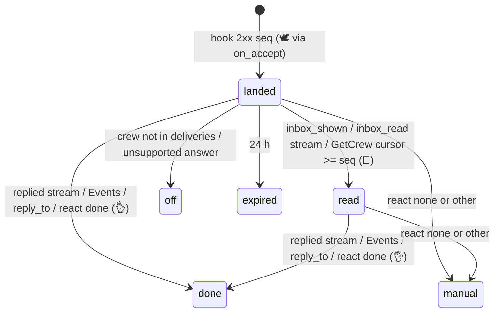

# Operator message read and done receipts

Design record, 2026-11-21 (stream update 2026-11-24): track each accepted operator Telegram message
through `landed` (🕊), `read` (👀) and `done` (👌) using one replacing
bot reaction per message (`setMessageReaction`), following the yard's native
event stream (`GET /events?after=<seq>`) with clean fallback to cursor polling
when a core lacks `inbox_read` or `/events`.

## Decisions

1. **Read access on unmodified upstream.**
   `GetCrew {"name": crew}` is a `Read` call in the public `Calls`
   contract (`internal/rpc/access.go`, `internal/rpc/api.go`) with no
   caller check in `store.GetCrew` (`internal/store/crew.go`). It
   returns the line session's `cursor`, `state`, `status` and `journal`.
   No core addition is needed.
   Every instance uses these reads independently of native-card ownership.
   `home` alone suffices; no operator identity or approval grant is needed.
   *Degrades off:* without `[yardr] home`,
   when the socket is absent, or when `GetCrew` omits an integer
   `cursor >= 0`.

2. **Mapping a Telegram message to its yard event `seq`.**
   The inbound hook's 2xx answer carries `seq` (`internal/hooks/receiver.go`),
   which is the event sequence `RecordHook` logs as kind `hook` and
   subscriptions index into the crew inbox (`internal/store/hooks.go`,
   `internal/store/subscriptions.go`). Duplicate deliveries answer the
   earlier `seq`. Because inbox cursors are yard-wide sequences, a crew
   member that never received the message would still pass its seq;
   therefore `EventsSince [seq-1, 1]` verifies once per message that the
   `hook` event came from our source and names the conversation's crew
   (`_quota_agent`) in `data.deliveries`. Read means the yard has shown the message
   to the crew member (`inbox_shown`) or the crew acked it (`inbox_read`,
   `GetCrew.cursor >= seq`).
   *Degrades off:* if `EventsSince` is unsupported, refused or returns a
   mismatched event, or if the crew is not in `data.deliveries`, the row
   moves to `off`.

3. **Done signals.**
   `yardr reply <seq>` logs `replied` on the crew member's journal after
   `/v1/send` returns, carrying `data.seq`, `data.source` and `data.crew`
   (`internal/store/threads.go`). Because thread replies carry no parent
   for envelope type `message` (`internal/hooks/reply.go`), the bridge
   reads `Events [journal, n]` (64 doubling to 1024, validated by
   `run_asks._validate_events`) only after a non-reaction, non-readstate
   ledger send, holding the send mark for two rounds with no newer send.
   Done also comes from a `/v1/send` with `reply_to` naming the message
   or a `react` call (`CLI` or `/v1/react`) with the `done` emoji; `none`
   or any other emoji sets `manual` and stops tracking.

4. **Stream, cadence, locking and typing isolation.**
   While `Bridge.run()` runs with `[reactions] read` and `[yardr] home`, a
   stream worker asks `Head`, opens `GET /events?after=<seq>` on `yard.sock`,
   and reconnects on any stream end with the last `seq` seen (`0.1` s initial
   backoff, capped at `5` s). At each connect it seeds cached crew status
   from `GetCrew` for crews with open rows, so a crew already in a working
   turn gets stream typing without waiting for its next `crew_status` event.
   Each `inbox_shown` or `inbox_read` (`data.session == ""`,
   `data.reader == crew`, `data.through >= seq`) transitions open `landed` rows
   to `read` (👀) at once — 👀 means the yard has shown the message to the crew
   member (`inbox_shown`) or the crew acked it (`inbox_read`), and whichever
   arrives first moves the row. Each line-session `crew_status` (`data.user`
   absent/empty, `data.crew == crew`, `data.status` in `working|idle|blocked|unknown`)
   and `crew_stopped` tracks that crew's turn status for typing without changing
   any message reaction; any legacy ledger row still in `working` settles once
   to `read` (👀) on the first refresh after upgrade.
   Each matching `replied` (`data.source`, `data.crew`, `data.seq`) transitions
   open rows (`landed`, `read`) to `done` (👌) at once, and each
   matching `hook` resolves `crew` early; `/v1/send reply_to` and `react`
   continue to act immediately. A background fallback round (`read_states.refresh()`,
   also called from `poll_once`) runs at most once every `5` monotonic seconds
   (`ROUND_SECONDS = 5`) only while open rows exist (`landed` or `read`),
   making zero native calls when idle. If `/events` is refused or
   `GetCrew` shows `cursor >= seq` after the stream caught up to `Head` without
   `inbox_read`, the fallback reason is logged once (cores without `inbox_shown`
   behave identically via `inbox_read` and the 5 s poll, with no new fallback
   logged). `landed` rows older than
   24 h move to `expired` without a reaction. Every reaction check, Telegram
   `setMessageReaction` and `read_states` state update runs under the reactions
   `flock`, stepping only forward (`landed -> read -> done`), using `readstate:<mid>:...` keys ignored by `Store.sent_since` so
   typing windows survive read reactions. When `[typing] seconds > 0`
   and the stream is active, typing runs only while a crew is `working` and has
   an open (`read`) row, in the thread of that crew's newest open
   row, stopping on idle, send, or the `seconds` safety cap (a send-stopped
   window resumes when the newest open row changes in the same turn); without
   a live stream, the accept-timer window stays unchanged.

## Unread nudge offer

When `[reactions] nudge_after` (`1`–`3600` seconds) is configured together
with `[reactions] read`, `[yardr] home`/`operator`, and the built-in `/nudge`:

The same preconditions apply on every instance, including `cards = false`.
Without `operator`, reads still work and the offer is off with its reason
in startup and `check-install`. Unsupported `NudgeSession` is logged at runtime.

1. **Reuse over a second card type:** Offers open via
   `TypedNudge.open_confirm(token=..., reply_to=mid, header=..., silent=True)`
   and use the existing `nudge:<token>:nudge` / `cancel` callback handler,
   operator verification, `NudgeSession` write, and `session_nudged`
   outcome follower. No new callback prefix or grant is added.
2. **Core capability probe:** `NudgeSession {}` is probed once per process
   on first eligible offer; `RPCUnsupported` (`no such method`) is cached
   and logged once, leaving upstream cores silent with zero writes.
3. **Zero message-text leakage:** The offered line is a fixed constant naming
   only the integer event `seq`, keeping operator message text out of the
   card and the agent's pane.
4. **Durability and close-on-read:** `read_states.offer_token` and the
   `typed_nudges` row (`message = None`) are saved atomically before the
   send under `typed-nudge:<token>:send`; a later round retries `not-sent`,
   replays confirmed sends, and retires ambiguous sends as offered. At most
   one offer per crew stays `open` at once, one offer per message ever, and
   moving out of `landed` (`read`, `done`, `manual`, `expired`, `off`)
   cancels an `open` offer under `ra.lock()` and edits away its buttons.
