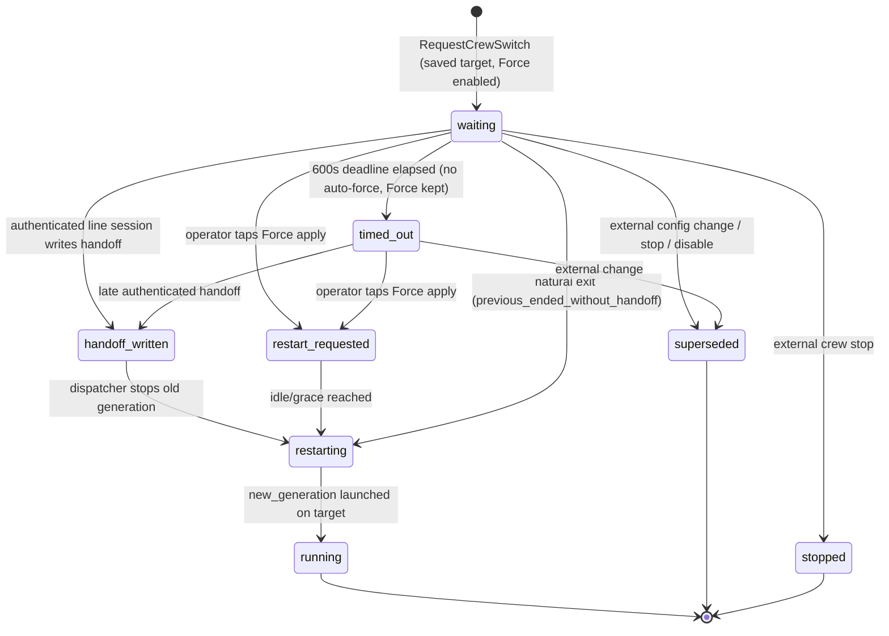

# Durable handoff model switching (`/switch_model`)

Design record for `/switch_model` (`bridge/model_switch.py`, `bridge/yard_commands.py`),
built against the core `crew_handoff_switch` v1 contract landed in `yardr` at
`bd7f54b4484321ce618c5224a9e419f3c9b94b55`. Source landing documents and tests
the contract offline; installation, service restarts and `set-commands` remain
the operator's actions.

## Core contract and capability gating

The bridge requires an explicit read-only capability marker before sending a
selector, admitting a switch, forcing an operation or running `--dry-run`:

```sh
yardr --home <home> crew switch capabilities --json
# requires exact JSON object {"crew_handoff_switch": 1} (integer 1)
```

Capabilities are never inferred from `yardr --version`. Cores without
`crew_handoff_switch: 1` (including public `52e22d57` and `v0.17.0`), malformed
JSON, unknown fields, non-integer values or non-zero exits refuse before any
SQLite reservation or mutation. A locally built core is only development/test
evidence, not evidence of a compatible public release.

| Surface | Name | Purpose and authority |
| --- | --- | --- |
| CLI / RPC read | `crew switch capabilities --json` / `CrewSwitchCapabilities` | Read-only capability probe (`{"crew_handoff_switch": 1}`) |
| CLI / RPC read | `crew show <crew> --json` / `GetCrew` | Current `revision`, `session_generation`, `launch`, `config`, `status`, context telemetry and `switch` |
| CLI / RPC read | `crew switch show <id> --json` / `GetCrewSwitch` | Durable receipt/alias lookup by original `request_id` or `action_id` |
| CLI / RPC write | `crew set ... --handoff --request-id ... --revision ... --session-generation ... --wait-seconds 600 --json` / `RequestCrewSwitch` | Socket-only operator mutation; atomically persists target config and handoff operation |
| CLI / RPC write | `crew restart <crew> --switch <op-id> --generation <op-gen> --action-id <action-id> --json` / `ForceCrewSwitch` | Socket-only operator mutation; switches operation to `force` and requests ordinary restart |

## Saved target vs active launch, milestones, and Force apply

`RequestCrewSwitch` persists the next-session target (`kind`, `model`, `args`,
and optional `env_file` with omitted preserved) and the `waiting` operation in
one store transaction. The running session keeps its actual launch (`crew.launch`)
until it stops and a replacement launches:

- **Request queued vs delivered vs handoff written:** `accepted_at` records when
  the core admitted the switch; `nudged_at` records only that the safe boundary
  nudge was submitted, not that the session read it; `handoff_written_at` and
  `handoff_note` record that the captured authenticated line session
  (`YARDR_CREW_GENERATION` + kernel shell process lineage) committed a fresh
  journal handoff and restart intent in one transaction.
- **Why restart accepted is not running:** CLI exit `0` on admission or Force,
  and states `restart_requested` / `restarting`, mean only that restart intent
  or shutdown started. `running` requires `crew.switch.state == "running"` with
  `running_at` and `new_generation != previous_generation` after the core
  launches a session whose actual `launch` matches the accepted target
  (`kind`, `model`, `fingerprint`). Desired config equality alone never settles.
- **Fixed 600-second deadline:** `WAIT_SECONDS = 600` (`--wait-seconds 600`).
  At expiry (`timed_out`), the saved target stays intact, switch nudges stop,
  age rotation cannot auto-force the switch, and the old session keeps running.
  A legitimate late handoff or natural exit (`previous_ended_without_handoff`)
  can still start the saved target and settle `running`; natural exit never
  fabricates a handoff or triggers a second restart.
- **Force apply:** Available from the first accepted card and after timeout.
  It is never automatic. On tap, the bridge verifies operator identity and
  binding, re-reads the native operation, reserves `force_action` and a row in
  `model_actions`/`switch_model_taps`, answers the callback, and edits the card
  to `"Force apply accepted, please wait. Ordinary restart waits for idle when
  applicable."` with buttons removed *before* running `crew restart --switch`.
  Force schedules an ordinary restart on the saved target without waiting for a
  handoff; busy sessions still wait for idle/grace.



## Poller order, metadata freshness, and card edits

`Bridge.poll_once` runs `getUpdates` (20-second quiet long poll) →
`run_asks.refresh()` → `siding_cards.refresh()` → `drain(updates)` →
`model_switch.refresh()`. Committing inbound taps before `model_switch.refresh`
ensures a pending refresh never consumes a stale Force proposal or restores
removed controls.

- **Bounded reads:** `model_switch.refresh()` enforces a shared `3`-second
  budget (`REFRESH_SECONDS = 3`). It performs one `crew show` (or `crew switch
  show` before recovery) per active operation per pass.
- **Metadata and freshness:** The card renders only core-exposed `status`
  (`working`, `idle`, `blocked`, `unknown`), `context_pct`/`context_window`
  with `context_at` reading time, `login_screen`/`failures`/`starting`, and
  elapsed time from persisted `accepted`/`deadline` timestamps. Active telemetry
  older than `45` seconds is tagged `(stale observation)`. Missing context
  renders `Context unavailable.` and never synthesizes a percent-done bar.
  Target `effort` and `env_file` are never recomputed or opened locally; the
  bridge renders `Target effort: unknown · env: unknown.` unless the core
  receipt exposes them.
- **Completed-stage trail:** When polls skip intermediate transitions,
  persisted timestamps (`nudged_at`, `handoff_written_at`, `restarting_at`,
  `running_at`) still render the full milestone trail (`requested → … → running
  on target`).
- **Idempotent presentation ledger:** Every card update edits the original
  selector message (`editMessageText` via `_reserve_and_deliver` with
  `not_modified=True`) under key
  `model-switch:<op-token>:message:<generation>:revision:<rev>`. Identical renders
  skip edits; deleted or uneditable messages persist `display_failure` without
  sending a replacement card.

```mermaid
sequenceDiagram
    participant U as Paired operator
    participant B as Bridge (SQLite + Poller)
    participant Y as Yard socket / CLI
    U->>B: /switch_model
    B->>Y: crew switch capabilities + crew show
    B->>U: Selector card (token + bound picks)
    U->>B: Tap pick callback (switch-model:s:<token>:<pick>)
    B->>Y: GetUser (verify_operator) + capabilities + crew show
    B->>B: BEGIN IMMEDIATE: reserve switch_model_taps, model_operations, model_actions
    B->>U: answerCallbackQuery ("Switch requested; please wait...")
    B->>Y: crew set --handoff --request-id <192-bit> --wait-seconds 600
    Y-->>B: Receipt (waiting, Force enabled)
    B->>U: editMessageText -> live card with Force apply
    Note over B,Y: Poller drains inbound taps before refresh()
    U->>B: Tap Force apply (switch-model:f:<token>:<gen>)
    B->>Y: crew switch show + GetUser
    B->>B: BEGIN IMMEDIATE: save force_action, switch_model_taps, model_actions
    B->>U: answerCallbackQuery + immediate edit ("Force apply accepted...")
    B->>Y: crew restart --switch <op-id> --generation <op-gen> --action-id <192-bit>
    B->>Y: poll refresh -> crew show (running, new_generation)
    B->>U: editMessageText -> Running on target (controls removed)
```

## Durable SQLite boundaries and recovery without replay

All switch durability lives in SQLite under `model_switch.locked()` (`flock` on
`<store>.model-switch.lock`) with `BEGIN IMMEDIATE` transactions:

- `switch_model_taps(update_id, pick, crew, state, at)` holds the 5-column
  tap-dedup record (`reserved`, `done`, `refused`, `unknown`); `model_actions`
  (`update_id` primary key) also fails replayed updates closed across upgrades.
- `model_selectors(token, update_id, value)` binds each selector to
  `bot_id`, `account_id`, `yard`, `yardr_source`, `realpath(yardr_home)`,
  `yardr_operator`, `user_id`, `chat_id`, `conversation_id`, `message_id`,
  `crew`, and canonical `[yardr.switch_model]` snapshot. Callbacks are
  `switch-model:s:<16-char-token>:<pick-id>` and
  `switch-model:f:<16-char-token>:<generation>` (`<= 64` UTF-8 bytes even with
  32-byte pick IDs). Retired selectors,
  changed config/picks, or mismatched bindings answer `"That model button is
  out of date."`.
  A digest of the complete native config, runner, directory, launch, enabled
  flag and session generation also binds the card to the definition shown.
  Tap-time reads compare that digest and use the freshly observed revision:
  status, cursor and context activity may advance the revision without making
  the card stale. A real config or session change refuses before reservation.
  That refusal is a durable tap/action record, so a replay after a crash cannot
  admit the rejected tap even if the native configuration has been restored.
  Selectors from older releases without this digest must be opened again.
- `model_operations(token, owner, active, value)` enforces at most one active
  operation per `(realpath(yardr_home), crew)` via partial unique index
  `model_operation_owner ON model_operations(owner) WHERE active=1`. A same-pick
  tap while unresolved acknowledges the original card without resetting the
  deadline; a different pick is refused. A no-op requires a running native
  session, exact pick/config equality and proof that the actual launch matches
  the complete config. `running_pick` compares the native v1 SHA-256 launch
  fingerprint, including args, env path and preserved launch inputs. It never
  opens an env file. Relative paths resolve against the live native server
  working directory from its verified pidfile when available, falling back to
  the yard home and process HOME; only a matching digest grants equality, so an
  unknown native server working directory cannot produce a false match. The previous confirmed
  receipt plus unchanged preserved definition remains a fallback for paths
  whose native resolution cannot be reproduced locally.
  The original selector becomes `"Already running <label>; nothing to switch."`
  with no controls, native mutation or operation reservation. A durable `noop`
  action and terminal selector notice support replay and card-edit recovery.
- `model_actions(update_id, token, value)` records per-update intent (`admit`,
  `force`, `existing`, `noop`, `refused`).

**Recovery and unknown receipts:**
- Request IDs (`tg-switch-<48 hex>`) and Force action IDs (`tg-force-<48 hex>`)
  carry 192 bits of randomness.
- Every native receipt and `crew.switch` object is strictly schema-validated
  against the v1 schema (exact required/optional keys, types, enums,
  `600`-second `deadline - accepted_at`, uint64 `handoff_note`,
  `new_generation != previous_generation` for `running`). Invalid or unexpected
  fields fail closed to `unknown` without settling or removing `active=1`.
- An unconfirmed/crashed admission never triggers a mutating retry, even if
  `crew.config` matches the pick. On reopen, `lookup()` queries `crew switch
  show <original-request-id> --json`. A receipt is adopted only when the bridge
  already saved the confirmed admission receipt (`admission_confirmed: true`
  with matching `id`, `generation`, `target`, `accepted_at`, `deadline`) or
  receives it on the live admission call; otherwise `UnmatchedReceipt` keeps
  the operation `unknown`, removes Force controls, and displays `"Native
  request could not be matched; operator reconciliation required. Nothing
  retried."`.
- A non-zero admission with an exact JSON `{"error": "..."}` response saves
  the error and confirms absence with `crew switch show`. The error is cleaned,
  bounded to 320 printable characters, redacted for configured env-file paths,
  logged and HTML-escaped on the card. An exact exit `3` with
  `{"error":"crew switch request: not found"}` settles an unconfirmed row as
  refused and inactive, atomically marks its original tap refused and retires
  its selectors. Old stuck rows recover on their next poll with `"not admitted"`
  when no admission error was saved. Confirmed admissions never settle from
  not-found evidence. Unexpected error shapes, transport failures and unmatched
  recorded requests remain unknown; nothing is retried automatically.
- If a Force tap crashed after reserving `force_action` but before native
  confirmation, a validated original-operation observation in `waiting` or
  `timed_out` (`mode == "handoff"`) clears `force_action`, increments
  `generation`, and restores a fresh Force button so only an explicit new
  operator tap can submit a new `action_id`.

## Rollout and rollback boundaries

The isolated native tests against `bd7f54b44843` reproduce both admission cases:
an identical launch/config pick with a fresh revision is accepted as another
handoff (`0`, no error); changing only crew status before admission returns
`1`, `{"error":"crew switch expected revision changed: stale"}` (57 bytes),
then lookup returns `3`, `{"error":"crew switch request: not found"}`.
Activity between the fresh tap-time read and admission can still refuse; the
bridge exposes that error and releases the reservation rather than retrying.
The native guard still protects the atomic write against every revision change.

- **Settings:** `[yardr.switch_model]`, its `picks`, `timeout`, and
  the `switch-model:` namespace govern `/switch_model`. While `[yardr.switch_model]`
  is set, any `switch_model` command/menu name and any prefix overlapping
  `switch-model:` are refused on load before any write.
- **Rollback:** Resolve or supersede any pending native switch, stop the unit,
  and restore the pre-edit settings file before running
  `install.sh --settings <settings> --root <root> --rollback`.
  Rolling back bridge code does not cancel a pending core switch or undo a
  saved crew target. Do not downgrade core while unresolved switch operations
  exist.
