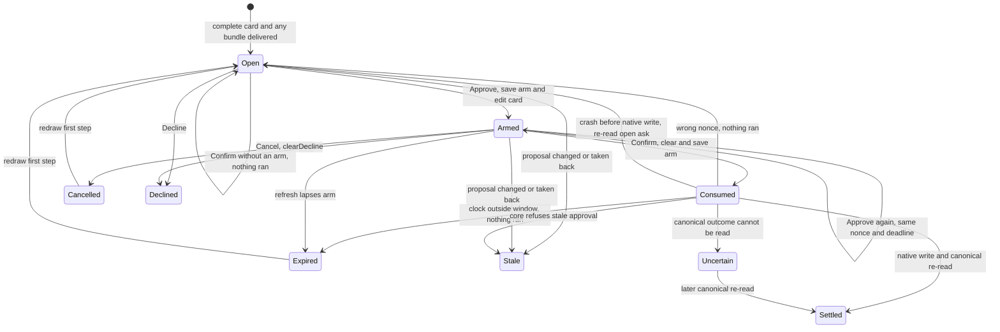

# Tap confirmation for weighty Telegram cards

Design record, 2026-11-10: approve, then confirm—a double tap on the card.
This replaces the phone-client gate described in [Native run cards](../../bridge/OPERATIONS.md#native-run-cards)
for the Telegram bridge's native run cards. The typed number is retired on
Telegram only. Routine run cards still approve in one tap; decision and siding
cards keep their existing behaviour.

## The gate belongs to the client

The core leaves the gate to the client: `weighed: true` is the client's word,
not proof the yard verifies. It still re-weighs the card, refuses stale
proposals and permits one approval per ask. No core call, grant, setting or
authority changes.

A keyboard client has no tap to double. Its typed number is the deliberate
step and also gates secrets before a value is read. The terminal, `yardr chat`
and MCP keep their number gates; MCP still carries no secrets. Footplate's
owner authentication is stronger than a tap, and the bead page keeps its
existing gate, including fresh sign-in for hosted strong cards.

The token's anatomy at each sink remains:

| sink | first step | deliberate second step | yard call |
|---|---|---|---|
| core | card with its weight | client's word after its gate | existing approval with `weighed: true` |
| Telegram native run card | Approve persists an arm and edits the bound card | Confirm carries that arm's nonce, same paired person/chat/topic, within 60 s | `ApproveAsk` with `weighed: true` |
| `yardr bead answer` | weight lines printed | ask number typed at a terminal | unchanged |
| `yardr chat` | card in view | ask number typed back | unchanged |
| MCP | `WeighedPrompt` | ask number typed back in the form | unchanged |
| Footplate | Approve control | owner authentication | unchanged |
| bead page | card in view | existing gate: hosted strong card needs fresh sign-in; otherwise the terminal where required | unchanged |

## Telegram's two taps

The bridge contract is [Native run cards](../../bridge/OPERATIONS.md#native-run-cards).
The first tap is `✓ Approve`. The bridge checks the paired human, chat, topic,
bound message and fresh native proposal, then persists
`pending = {expires: t+60, update, armed_at: t, nonce}`. The nonce is 16
hexadecimal characters from `secrets.token_hex(8)`; Confirm's callback is
`runask:<id>:confirm:<nonce>`, bound to that ledger row. `t` is the bridge
host's wall clock when it handles the first tap, since a callback carries no
tap time. Confirm is valid through `t+60`, inclusive; `now > expires` or
`now < armed_at` lapses it.

The bridge edits the same message, keeping the complete card visible and
adding: `Confirm ask <n> on <bead>: runs <command> · Tap Confirm within 60 s,
or Cancel.` The command comes from the fresh native ask and shortens only if
the added line would exceed Telegram's limit. Row one is
`[Cancel] [✕ Decline]`; row two is `[✓ Confirm ask <n>]`. Cancel takes
Approve's former position, so a reflex tap in the same place cancels. Confirm
appears only on that bound card, after any complete review bundle, never on a
summary.

Repeated Approve re-shows the same live nonce and deadline. Confirm repeats
all ownership, binding and fresh-proposal checks, then clears and saves the
arm before any approval write. A missing arm, wrong nonce, expired window,
backward clock, stale proposal or replay cannot approve. A wrong nonce clears
the arm; invalid origins leave it untouched. Cancel restores the open card
with `Cancelled; nothing ran`; Decline records the native decline without
another step. Any other tap, reply, reaction or number sends no approval. A
bound reply exactly matching the ask number gets
`Typed numbers no longer approve in Telegram; tap Approve, then Confirm.
Nothing ran.` Other replies and free-standing numbers keep ordinary routing.

A restart preserves a current arm. Each poll lapses expired arms before
draining queued updates. A crash after saving an arm but before the edit runs
nothing; Approve repairs the display. Consumption before the native write
prevents replay. After a write, the bridge re-reads the canonical ask; an
unreadable outcome stays uncertain, with no blind write retry. Settled means
the canonical answer is known, not that execution succeeded.

## Migration and rollback

Rows armed under the typed gate (`pending` without `nonce`) are lapsed by the
first refresh and redrawn unarmed, never converted. Their notice says the old
confirmation ended with a bridge update and nothing ran. Unarmed cards need no
redraw and enter the new gate on their next Approve tap.

The previous bridge release reads an armed row's retained `expires` and
`update` as its typed confirmation; its callback pattern rejects `confirm`
data. After `install.sh --rollback`, use that release's typed gate or cancel
and reopen the card. Canonical answers already written remain.

Source landing does not install or activate the bridge. The operator owns
installation and starts the service after authorizing the change. Live
usability is checked on a weighty card: Approve shows Confirm, Cancel restores
it, and Approve then Confirm records one canonical answer and one change event
carrying `approved`.
