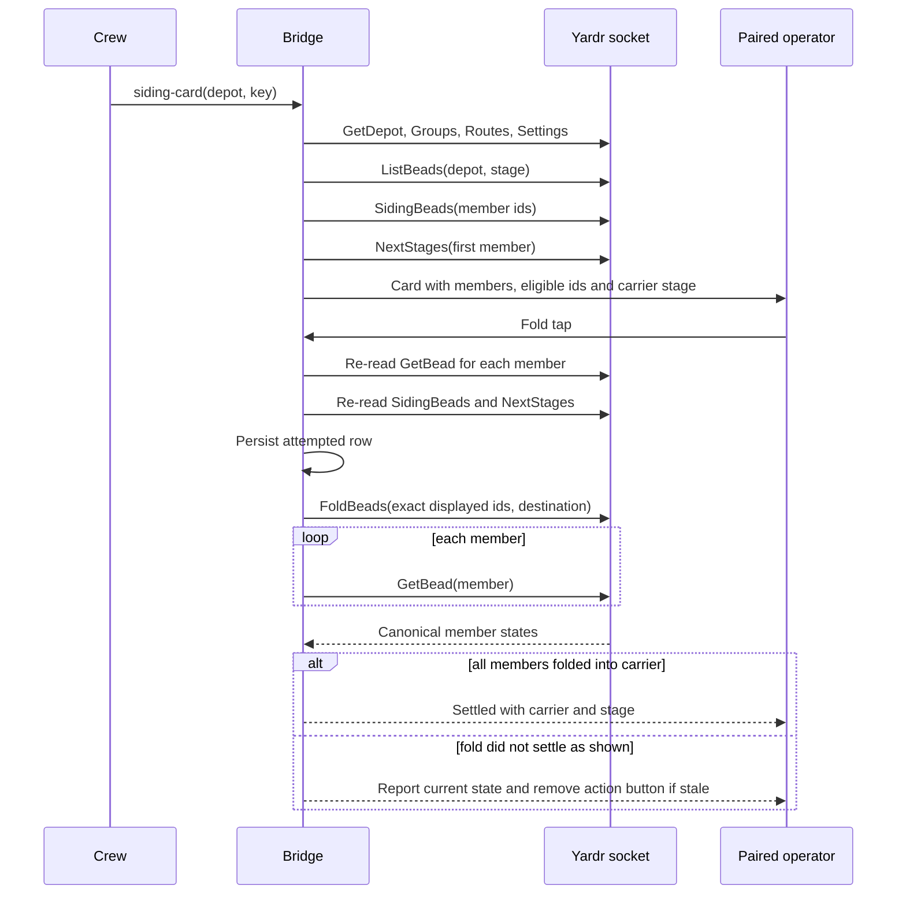

# Upstream alignment

Decision record for the bridge's aligned-yardr and plain-upstream behaviour.
The aligned build at `11f81f38` contains upstream `09fa95be` plus 13 local
replays. The public socket contract below is the Calls section of
`docs/api.md` at `11f81f38`. The installed build at the time of this record
was `10533b9e`, before that alignment.

## Calls made by the bridge

The bridge uses object arguments for the public contract. Yardr's own calls
use arrays; their shapes can change with a build, so the native integration
tests pin these calls against both `11f81f38` and plain upstream
`09fa95be`.

| Call | Classification | Use |
|---|---|---|
| `GetUser` | Public contract | Read the paired operator |
| `Bead` | Public contract | Read an ask and its current proposal |
| `UserAsks` | Public contract | Read the operator's decision queue |
| `ApproveAsk` | Public contract | Approve a run ask |
| `DeclineAsk` | Public contract | Decline a run ask |
| `AnswerAsk` | Public contract | Answer a decision ask |
| `DeferAsk` | Public contract | Put a decision ask aside |
| `AnswerAskExpected` | Public contract | Answer a decision ask at the read turn |
| `DeferAskExpected` | Public contract | Put aside a decision ask at the read turn |
| `DeclineAskExpected` | Public contract | Decline a decision ask at the read turn |
| `GetBead` | Yardr array call | Read a bead for siding-card reconciliation |
| `GetDepot` | Yardr array call | Read a depot for siding-card discovery |
| `Groups` | Yardr array call | Find a siding group |
| `Routes` | Yardr array call | Find a stage routed to that group |
| `Settings` | Yardr array call | Read yard settings used by siding discovery |
| `ListBeads` | Yardr array call | List the beads in a depot stage |
| `SidingBeads` | Yardr array call | Read siding points and fold eligibility |
| `NextStages` | Yardr array call | Find the next stage for a fold or release |
| `Advance` | Yardr array call | Release one siding bead to its next stage |
| `FoldBeads` | Yardr array call | Fold the exact eligible members shown on a card |

The array calls are yardr's own interface, not the stable public contract.
The native tests build isolated yardr copies at both revisions and exercise
the card paths against their real RPC and store implementations. A build that
does not answer with the expected whole shape is refused before the bridge
sends an actionable card.

## What differs by build

The aligned build accepts group-set cards that include `model=`. Plain
upstream does not support that local group-set field, so the bridge returns
its fallback instead of presenting a card it cannot apply.

Replacing-source cards also depend on the grants text that says whether grants
will remain or none will remain. The aligned build provides that text. Plain
upstream omits it, so the bridge refuses the replacement card with its
fallback before sending it. These are the two local-only differences; the
remaining supported cards use upstream's shapes on both builds.

## Siding cards on plain calls

Siding discovery reads the depot, groups and routes, then uses ordinary
bead-listing and yardr's siding reads. `ListBeads` identifies every member
waiting in the routed stage. `SidingBeads` supplies points and whether a
fold would take each bead. `NextStages` supplies the carrier's destination.
The card names the members, exact eligible proposal and destination.

On a tap, the bridge re-reads each member, the siding eligibility and the
destination. It records the card attempt before calling `FoldBeads` once with
exactly the displayed ids and that destination. It then reads every member
again with `GetBead` to reconcile the canonical result. A successful fold
settles to its carrier; unchanged open members leave the card open; any other
state is reported as stale or refused without another action button.

`FoldBeads` is atomic and refuses closed, worked, blocked, mixed-depot or
mixed-flow members. `SidingBeads` also keeps held or asked beads out of the
proposal, since the plain fold does not refuse those states. The plain fold
has no revision guard, so a member changed after the re-read is folded as it
stands, including a change into a held or asked state. The decision accepts
that race; the store still makes a fold all-or-none and refuses the states it
checks. A repeated tap reconciles any recorded attempt before anything else.
Members that all read back in one carrier settle the card, so the next tap
reports them folded. Members in any other state leave the card stale, with no
action button. Members that all read back open in the shown stage mean nothing
folded: the card stays open, and a later tap folds again only when a re-read
finds the shown members unchanged.

The accepted release decision moves one bead alone to the next stage. The
card uses the plain `Advance` call with the stage and revision it read; a
repeated or stale tap is refused by the store. A plain Release that leaves
the bead in the siding is not the chosen action.

## Skills decision S1

The skill-install card and crew self-service adds were removed. The operator
continues to use `skill add`, `skill rm`, `skill list`, `skill show` and
`skills=` from the terminal. Skill assignment remains an operator action.

## Install, activation and rollback

The recorded rollout order is:

1. Upgrade yardr to the aligned build.
2. Install the bridge release with `install.sh --settings <file>` for each
   bridge instance.
3. Re-apply the pack with
   `yardr pack apply <root>/pack --source-env tgbridge=<file>`.
4. Refresh each installed skill with
   `yardr skill add <root>/current/skills/<name>`.
5. Restart each bridge service.

Rollback uses `install.sh --settings <file> --rollback`, then reapplies the
pack with `yardr pack apply <root>/pack` and restarts the service. The
preceding bridge release was verified to keep polling when it reads the new
siding-ledger rows.

The operator owns installation and activation; source landing alone does
neither. The operator authorizes the pack apply, skill refresh and restart.
This record changes documentation only: it does not install yardr or the
bridge, apply a pack, refresh skills, restart a service or exercise a live
yard.

After installation, check a throwaway synthetic depot with two beads in a
siding: publish the card, fold both, verify the carrier lists both parts, and
unfold it. Also raise and approve a group-set `effort=` card. These checks
confirm that the live card paths are usable after activation.
